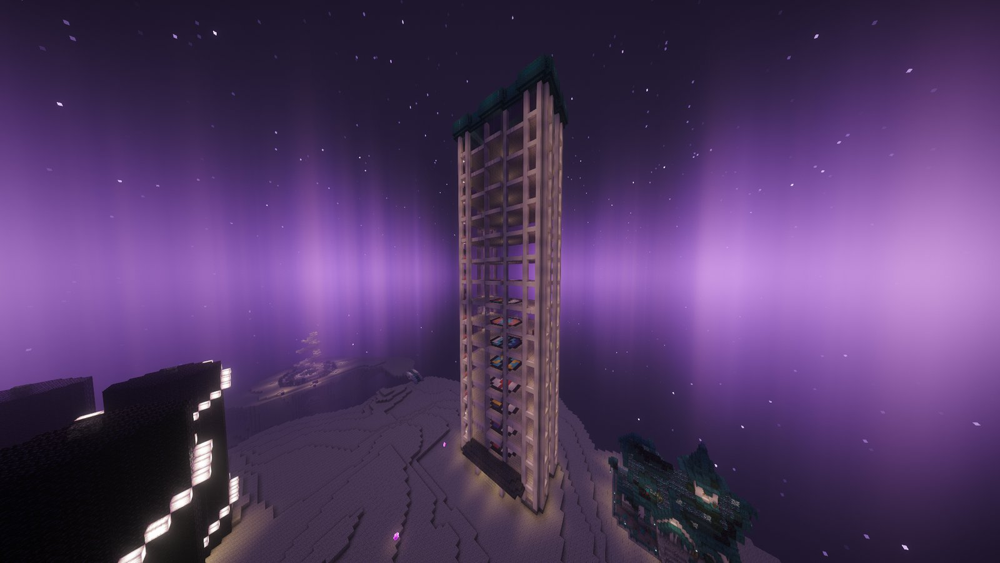

<!-- Source: network/docs/BATTLE-TOWER.md (audited 25 Oct 2026 against test-server/live survival: entry, $500 fee + exemptions, 20 floors, run rules, Continue/Rest, how a streak ends, tiers and BP, trainers, signature teams, rules and bans, blocked commands, BP, the 71-item shop, the move tutor, leaderboard, commands). Operator notes and known gaps left out. Screenshot: Media/screenshots/battle tower.png. -->

# 🗼 Battle Tower



The Battle Tower is an endless run of trainer battles. Bring a small team, build the longest win streak you can, and earn <strong>Battle Points (BP)</strong> to spend on held items, rare goods and tutor moves.



<figure><figcaption>
The Battle Tower
</figcaption></figure>

***

## 🚪 Getting in

| | |
| --- | --- |
| 📍 **Where** | In **the End** on **Survival**. Type `/battle_tower` to go there. |
| 🔑 **Requirement** | The first **4 gym badges of any one region** (they don't stack across regions) |
| 💵 **Entry fee** | **$500** to start a new run. Continuing a run you rested out of is free. |
| ⭐ **Supporters** | Always enter for free |

Talk to the **receptionist** and choose:

* **Singles**: bring exactly **3** Pokémon
* **Doubles**: bring exactly **4** Pokémon
* **Leaderboard**: the best streaks
* **Information**: every rule, straight from the server

There are 20 floors, so up to **20 players** can be in the Tower at once. If every floor is busy, you'll be told and keep your money.

***

## ⚔️ The run

* Every Pokémon is set to **level 50**. Your real levels and EXP aren't touched.
* **No items** in battle: no Potions, Revives or Full Restores.
* You're **fully healed** between every battle.
* Your **team is locked** when the run starts. Changing it ends your run.
* The trainers' held items are hidden, just like the real Battle Tower.
* While you're in a run you can't use commands that would swap your team or escape, such as `/pc`, `/gts`, `/home`, `/spawn`, `/warp`, `/rtp`, `/hub` and teleport requests.

### After every win

Two buttons appear in chat:

* **\[ Continue ]**: face the next trainer
* **\[ Rest ]**: leave the Tower and **keep your streak** for next time. Coming back is free.

You can't rest in the middle of a battle. If a battle ever freezes, a **\[ Leave the battle ]** button appears after 5 minutes so you can get out with your streak safe.

### How a streak ends

| | Streak kept? |
| --- | --- |
| Pressing **Rest** between battles | ✅ Kept |
| Leaving a battle that froze (after 5 minutes) | ✅ Kept |
| Losing a battle | ❌ Lost |
| Walking out of the Tower or leaving the End | ❌ Lost |
| Disconnecting or switching to the Hub mid-run | ❌ Lost |
| Changing your team mid-run | ❌ Lost |



<strong>Always press Rest before you log off.</strong> Logging off without resting is the most common way to lose a streak.



A **100 win streak** is announced to the whole server.

***

## 📈 Difficulty and BP

Every 10 wins, the trainers get tougher and you earn more BP per win. Both stop rising at a **90 win streak**.

| Your streak | BP per win | What you'll face |
| --- | --- | --- |
| 0 to 9 | 1 | Ordinary Pokémon |
| 10 to 19 | 2 | Ordinary Pokémon |
| 20 to 49 | 3 to 5 | Sub-legendaries, Paradox and Ultra Beasts start appearing |
| 50 to 79 | 6 to 8 | Box-art Legendaries can appear |
| 80 to 89 | 9 | Two Legendaries on every team |
| **90+** | **10** | The toughest teams in the Tower |

| Streak reached | Total BP earned |
| --- | --- |
| 10 | 11 |
| 25 | 47 |
| 50 | 155 |
| 100 | 559 |
| 250 | 2,059 |
| 500 | 4,559 |

One unbroken 100 win streak pays **559 BP**, while ten separate 10 win runs pay only 110. Long streaks are where the BP is.

### The trainers

There are over 2,600 Tower trainers with competitive teams, real EV spreads and smart AI that switches and times its Tera and Megas well. You'll never face the same trainer twice in one tier.

* **Tower Aces** are themed teams scattered through the Tower, including tributes to gym leaders and Elite Four members.
* **Seven signature teams** only appear past a **90 streak**, and they're the hardest fights in the building, with Pokémon like Arceus, Ultra Necrozma and Mega Darkrai. Some use Pokémon that players aren't allowed to bring.

***

## 📏 Tower rules

Type `/bt_info` in game to see every rule. You can also type `/bans` and click the toggle at the top to switch to the **Battle Tower** ban list. Your team is checked before **every** battle.

* Exactly **3** Pokémon for singles, **4** for doubles
* At most **1 Legendary** and **1 Paradox** Pokémon per team
* No items during battles

🚫 Banned Pokémon (36)

Arceus, Aereon, Evereon, Chi-Yu, Chien-Pao, Calyrex, Deoxys, Dialga, Palkia, Giratina, Eternatus, Ho-Oh, Koraidon, Miraidon, Zacian (Crowned), Zamazenta (Crowned), Black Fog, MT, MT2, Shadow Lugia, Shadow Mewtwo, Armored Mewtwo, Black Tyranitar, Crystal Onix, Crystal Steelix, Galarian Slowbro Mega Y, Snowman Snorlax, Bloodmoon Ursaluna, Dracovish, Flutter Mane, Urshifu, Xerneas, Yveltal, Virus Groudon, Primal Dialga, Illusion Rayquaza.

🚫 Banned abilities, moves, Tera Types and items

**Abilities:** Arena Trap, Moody, Power Construct, Shadow Tag, Sand Veil, Snow Cloak, Tangled Feet.

**Moves:** Sheer Cold, Fissure, Guillotine, Horn Drill, Dragon Ascent, Baton Pass, Last Respects, Geomancy, Shed Tail, Assist, Dark Void, Double Team, Minimize, Acupressure, Prism Armor.

**Tera Types:** Shadow, Crystal.

**Held items:** every Z-Crystal, plus the Rusted Sword, Rusted Shield, Red Orb, Blue Orb, Gengarite, Kangaskhanite and both Shadow Mewtwonites.

***

## 💰 Battle Points and the BP Shop

Type `/bp` to check your Battle Points. Your balance is the same on the Hub and Survival. BP can't be traded or given away.

Spend it with `/bp_shop` or at the shop NPC:



| BP | Items |
| --- | --- |
| 12 | Focus Sash, Bright Powder, Quick Claw, Red Card, Room Service, Blunder Policy, Utility Umbrella |
| 15 | Rocky Helmet, Shell Bell, Wide Lens, Scope Lens, White Herb, Throat Spray, Eject Button, Protective Pads, Black Sludge |
| 18 | Expert Belt |
| 20 | Light Clay, Terrain Extender, Punching Glove, Safety Goggles, Heat Rock, Damp Rock |
| 25 | Loaded Dice, Mirror Herb, Air Balloon, Heavy-Duty Boots, Metronome |



| BP | Items |
| --- | --- |
| 30 | Ability Shield, Weakness Policy, Clear Amulet |
| 32 | Eviolite |
| 35 | Covert Cloak |
| 40 | Choice Scarf, Choice Band, Choice Specs, Leftovers, Razor Claw, Razor Fang, Dragon Scale, Up-Grade, Prism Scale, Deep Sea Scale |
| 45 | Assault Vest |
| 50 | Protector, Reaper Cloth, Dubious Disc, Electirizer, Magmarizer, Sachet, Metal Alloy |
| 55 | Life Orb |



| Item | BP | What it does |
| --- | --- | --- |
| Ability Capsule | 12 | Swaps between regular abilities |
| Ability Patch | 24 | Gives the hidden ability |
| Rare Candy | 32 | One level |
| Fertility Candy | 32 | +1 Fertility for breeding |
| Booster Pack | 40 | A pack of Pokémon cards |
| Silver Cap (HP, Atk, Def, SpA, SpD, Spe) | 75 each | Maxes one IV through hyper training |
| Dizygotic Booster | 75 | An extra egg for your next 5 daycare eggs |
| Sparkling Booster | 150 | Better shiny odds for your next 5 daycare eggs |
| Grow Card | 150 | Makes a Pokémon one size bigger (XS → S → M → L → XL) |
| Shrink Card | 150 | Makes a Pokémon one size smaller |
| Devolution Relic | 200 | Reverts a Pokémon one stage |
| **Golden Bottle Cap** | **360** | Maxes every IV |
| Master Candy | 500 | Sets a Pokémon to level 100 |
| **Alpha Card** | **1,250** | Turns a Pokémon into an Alpha |



Size Cards can't be used on Alphas.

***

## 🎓 The move tutor

The Tower's move tutor sells moves you can't get any other way, paid in BP. Right-click the tutor, click a Pokémon in your party, then pick a move and confirm. A barrier block means that Pokémon has nothing to learn.

It sells:

* **Egg moves**, so you don't have to breed for them
* **Champions movepool moves** from the official tutor lists
* **Tera Blast**, which Cobblemon doesn't teach any other way

| BP | Moves |
| --- | --- |
| 16 | Tera Blast |
| 24 | Low-value utility moves |
| 32 | Ordinary moves |
| 48 | Good moves |
| 56 | Strong moves |
| 64 | The best moves, like Zap Cannon and Ice Hammer |

***

## 🏆 Leaderboard

Type `/bt_top` (or `/bt_top singles` or `/bt_top doubles`) to see the top 10 streaks. Your best streak is tracked separately for singles and doubles, and you never lose a personal best.

***

## ⌨️ Commands

| Command | What it does |
| --- | --- |
| `/battle_tower` | Go to the Battle Tower (needs 4 badges from one region) |
| `/bp` | Check your Battle Points |
| `/bp_shop` | Open the BP Shop |
| `/bt_top [singles\|doubles]` | The best streaks |
| `/bt_info` | Every Tower rule |
| `/bans` | Ban lists. Use the toggle at the top to switch to the Battle Tower bans. |
