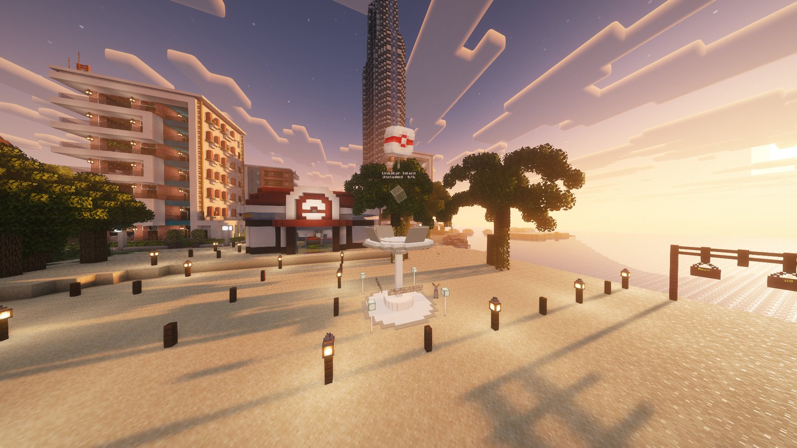

<!-- Sources: dev/gogyms/src (player messages, MAX_DEFENDERS 6, MAX_HEARTS 3, battle flow, Rocket invasion), test-server/config/gogyms/config.json (battleLevel 50, blockedGimmicks, reclaimLockMinutes 5, incomePerDay 1000, heartDecayHours 24, healCheersPerDay 6, boostHours 24, dailyResetHour 4 Australia/Sydney, noClaimRadius 16, visibleRadius 80, rocket.*),
owner 15 Oct (maxGymsPerPlayer raised 3 -> 6 on live), network/_upload/{hub,survival}/config/gogyms/rules.json (ban list), Downloads/survival logs/logs/latest.log ("Wild Gyms loaded: 62 gym(s)"), rules.json alias rule 12. -->

# GO Gyms



GO Gyms work like the gyms in Pokémon GO. Join a team, claim gyms with your Pokémon, defend them from rival teams, and earn money every day for each gym you hold.



<figure><figcaption>
A GO Gym
</figcaption></figure>

***

## 🔴🔵🟡 Pick a team

Type `/teams` and choose one of three teams:

| Team | Motto |
| --- | --- |
| 🔴 **Valor** | Strength and courage. Win through power. |
| 🔵 **Mystic** | Wisdom and calm. Win through strategy. |
| 🟡 **Instinct** | Trust your gut. Win through instinct. |


⚠️ This is a long-term choice. Pick the team you want to stick with.


Type `/teams leaderboard` to see which team holds the most gyms right now, plus the weekly and all-time standings. The week resets on Monday at 4am.

***

## 📍 Finding gyms

GO Gyms stand in villages and towns across Survival, and there are a few on the Hub too. You'll see them from 80 blocks away, and each one shows the colour of the team that holds it.

***

## 🚩 Claiming and defending



### Claim a gym

Right-click an **unclaimed** gym, or one your team already holds, and choose a Pokémon from your party to place as a defender.



### Your Pokémon stays there

Your defender leaves your party and stays in the gym. You **can't take it back early**. It comes home to your **PC** once it runs out of hearts.



### Earn money every day

You earn **$1,000 a day** for every gym you're defending, paid at the 4am daily reset.



| Rule | |
| --- | --- |
| 🏠 **Defenders per gym** | Up to 6, one per player |
| 🔢 **Gyms per player** | Up to 6 at a time |
| ❤️ **Hearts** | Each defender starts with 3 hearts |
| 💔 **Losing hearts** | A defender loses 1 heart every time an attacker beats the gym, and 1 heart every 24 hours |
| 🏃 **Going home** | At 0 hearts the defender goes back to your PC. When every defender has gone, the gym becomes unclaimed. |

***

## ⚔️ Attacking a rival gym

Right-click a gym held by another team to battle it. You face **all of its defenders** in one battle.

* **Win** and every defender in that gym loses a heart.
* **Lose** and the gym holds.
* Only one player can battle a gym at a time.
* After your team loses a gym, it can't reclaim it for 5 minutes. Other teams can.

You can also battle a gym your own team holds, to practise against its defenders. It scores nothing and changes nothing.

***

## 📏 Battle rules

| | |
| --- | --- |
| 📊 **Level** | Both sides fight at **level 50** |
| 🎒 **Items** | Held items are allowed. Bag items (potions and so on) are not. |
| 🚫 **Gimmicks** | No Mega Evolution, Z-Moves, Dynamax, Terastallization or Ultra Burst |
| 🌟 **Legendaries** | Allowed, with no limit |

**Banned at GO Gyms:** Evereon, Eternamax Eternatus, Primal Dialga, Primal Groudon, Primal Kyogre, Virus Groudon, Armored Mewtwo, any Shadow Pokémon, Rayquaza that knows Dragon Ascent, the Ultranecrozium Z, the Red and Blue Orbs, and Shadow and Crystal Tera Types.

***

## 📣 Cheers

Hold a raid **cheer** item and right-click a gym where **you** have a defender to cheer it on.

| Cheer | Effect | Limit |
| --- | --- | --- |
| ❤️ **Heal Cheer** | +1 heart for your defender | 6 a day |
| ⚔️ **Attack Cheer** | +50% Attack and Sp. Atk for 24 hours | 1 a day |
| 🛡️ **Defense Cheer** | +50% Defence and Sp. Def for 24 hours | 1 a day |

***

## 🚀 Team Rocket invasions

Every so often, **Team Rocket** takes over every GO Gym at once.

* Defenders are held, not harmed. They don't lose hearts, and you still earn your daily money.
* Every player can fight the Rocket trainers at any gym, from Grunts all the way up to **Giovanni**. You need to be on a team first.
* Damage carries over: the next trainer picks up where you left off. Knock out the last Rocket Pokémon at a gym to liberate it for a bonus.
* An invasion lasts about **2 hours**.

| Reward | Who gets it |
| --- | --- |
| **$50,000 + 3 Team Rocket Crate keys** | Everyone on the team that did the most damage |
| **1 Team Rocket Crate key** | Everyone else who did at least 100 damage |

***



Building around a GO Gym to hide it or block it is against the <a href="../getting-started/rules.md">rules</a>. You also can't claim land within 16 blocks of a gym.


