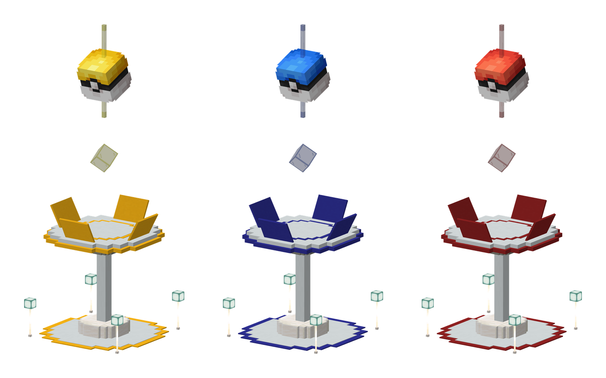

<!-- Sources: dev/gogyms/src (player messages, MAX_DEFENDERS 6, MAX_HEARTS 3, battle flow, Rocket invasion, underdog bounty, one species per gym), test-server/config/gogyms/config.json (battleLevel 50, blockedGimmicks, reclaimLockMinutes 5, incomePerDay 1000, heartDecayHours 24, healCheersPerDay 6, boostHours 24, dailyResetHour 4 Australia/Sydney, noClaimRadius 16, visibleRadius 80, uniqueSpeciesPerGym, underdogBounty.* base 1000 perHour 250 max 10000 minHoldMinutes 60 minDefenders 2 nearbyRadius 32, rocket.* minParticipationDamage 100 liberationBonus 300 settleGraceMinutes 3 winnerMoney 50000),
config/gogyms/rocket_teams.json (trainer names, boosts 1.25 / 1.3 / 1.4),
owner 15 Oct (maxGymsPerPlayer raised 3 -> 6 on live), owner 27 Oct (first live invasion ran 60 minutes), network/_upload/{hub,survival}/config/gogyms/rules.json (ban list), Downloads/survival logs/logs/latest.log ("Wild Gyms loaded: 62 gym(s)"), rules.json alias rule 12. -->

# GO Gyms



GO Gyms work like the gyms in Pokémon GO. Join a team, claim gyms with your Pokémon, defend them from rival teams, and earn money every day for each gym you hold.



<figure><figcaption>
GO Gyms held by Instinct, Mystic and Valor
</figcaption></figure>

***

## 🔴🔵🟡 Pick a team

Type `/teams` and choose one of three teams:

| Team | Motto |
| --- | --- |
| 🔴 **Valor** | Strength and courage. Win through power. |
| 🔵 **Mystic** | Wisdom and calm. Win through strategy. |
| 🟡 **Instinct** | Trust your gut. Win through instinct. |


⚠️ This is a long-term choice. Pick the team you want to stick with.


Type `/teams leaderboard` to see how many gyms each team holds, plus the weekly and all-time standings. The week resets on Monday at 4am.

***

## 📍 Finding gyms

GO Gyms stand in villages and towns across Survival, and there are a few on the Hub too. You'll see them from 80 blocks away, and each one shows the colour of the team that holds it.

<figure><figcaption>
A GO Gym on Cinnabar Island
</figcaption></figure>

***

## 🚩 Claiming and defending



### Claim a gym

Right-click an **unclaimed** gym, or one your team already holds, and choose a Pokémon from your party to place as a defender.



### Your Pokémon stays there

Your defender leaves your party and stays in the gym. You **can't take it back early**. It comes home to your **PC** once it runs out of hearts.



### Earn money every day

You earn **$1,000 a day** for every gym you're defending, paid at the 4am daily reset.



| Rule | |
| --- | --- |
| 🏠 **Defenders per gym** | Up to 6, one per player |
| 🧬 **One of each species** | Each species can only defend a gym once. If a gym already has a Pikachu, nobody can add another. Forms and shinies count as the same species, so an Alolan Raichu can't join a gym that has a Raichu. |
| 🔢 **Gyms per player** | Up to 6 at a time |
| ❤️ **Hearts** | Each defender starts with 3 hearts |
| 💔 **Losing hearts** | A defender loses 1 heart every time an attacker beats the gym, and 1 heart every 24 hours |
| 🏃 **Going home** | At 0 hearts the defender goes back to your PC. When every defender has gone, the gym becomes unclaimed. |

***

## ⚔️ Attacking a rival gym

Right-click a gym held by another team to battle it. You face **all of its defenders** in one battle.

* **Win** and every defender in that gym loses a heart.
* **Lose** and the gym holds.
* Only one player can battle a gym at a time.
* After your team loses a gym, it can't reclaim it for 5 minutes. Other teams can.

You can also battle a gym your own team holds, to practise against its defenders. It scores nothing and changes nothing.

***

## ⭐ Underdog bounties

The team that holds the **most gyms** has a price on its gyms. If your team holds **fewer** gyms, knock every defender out of one of their gyms and you collect an **underdog bounty**.

| | |
| --- | --- |
| 💰 **How much** | $1,000, plus $250 for every full hour the gym has been held, up to **$10,000** |
| ⏱️ **Held long enough** | The gym must have been held for at least an hour |
| 🏠 **Defended enough** | The gym must have had at least 2 defenders at once while it was held |
| 🏆 **Who gets it** | The player whose win knocks out the gym's last defenders |

* Gym counts include every gym on both the Hub and Survival.
* If two teams are tied for the most gyms, both count as leading, and the third team can collect from either of them. The two leading teams can't collect from each other.
* Bounties pause while Team Rocket holds the gyms.

**How to spot one:**

* Bounty gyms show a gold **★ Underdog bounty** line on their label, with the current amount.
* The **Battle this gym** button shows the bounty you'd earn.
* Walk near a bounty gym and the amount pops up above your hotbar.
* When you join, and whenever a different team takes the lead, you'll get a chat message saying which team to target.

***

## 📏 Battle rules

| | |
| --- | --- |
| 📊 **Level** | Both sides fight at **level 50** |
| 🎒 **Items** | Held items are allowed. Bag items (potions and so on) are not. |
| 🚫 **Gimmicks** | No Mega Evolution, Z-Moves, Dynamax, Terastallization or Ultra Burst |
| 🌟 **Legendaries** | Allowed, with no limit |

**Banned at GO Gyms:** Evereon, Eternamax Eternatus, Primal Dialga, Primal Groudon, Primal Kyogre, Virus Groudon, Armored Mewtwo, any Shadow Pokémon, Rayquaza that knows Dragon Ascent, the Ultranecrozium Z, the Red and Blue Orbs, and Shadow and Crystal Tera Types.

***

## 📣 Cheers

Hold a raid **cheer** item and right-click a gym where **you** have a defender to cheer it on.

| Cheer | Effect | Limit |
| --- | --- | --- |
| ❤️ **Heal Cheer** | +1 heart for your defender | 6 a day |
| ⚔️ **Attack Cheer** | +50% Attack and Sp. Atk for 24 hours | 1 a day |
| 🛡️ **Defense Cheer** | +50% Defence and Sp. Def for 24 hours | 1 a day |

***

## 🚀 Team Rocket invasions

Every so often, **Team Rocket** takes over every GO Gym on the network at once. You'll see an announcement in chat when it starts, and the gyms turn black with a big red **R** above them. An invasion usually lasts an hour or two, and you'll get a warning in chat 10 minutes before Team Rocket leaves.

### What happens to the gyms

* The real defenders are held, not harmed. They don't lose hearts, and their trainers still earn their daily money.
* Nobody can place defenders or cheer at a gym while Team Rocket holds it.
* Every gym goes back to its team the moment Team Rocket leaves it.

### Fighting Team Rocket

Right-click a Rocket gym and choose **Fight Team Rocket**. You need to be on a team first. Each gym is held by one Rocket trainer:

| Trainer | Their Pokémon hit and take hits |
| --- | --- |
| Team Rocket Grunt | 25% harder |
| Rocket Admins (Archer, Ariana, Proton, Petrel) | 30% harder |
| Rocket Executive | 30% harder |
| Rocket Scientist | 30% harder |
| **Giovanni** | **40% harder** |

* Rocket trainers bring tough, villainous teams. Expect Dark and Poison types, Paradox Pokémon, legendaries and a few nasty surprises.
* Rocket trainers never switch out on purpose. Each Pokémon fights until it faints.
* The normal battle rules still apply to **your** team, including level 50 and the ban list.

### Damage carries over

Every gym has a **shared health pool**. Whatever damage you deal stays, and the next trainer picks up where you left off, so work together to wear each trainer down.

* Damage is scored in percent of a Pokémon's HP: knocking out one Rocket Pokémon from full health is **100 damage**.
* Your damage counts for your team even if you lose the battle.
* Knock out the **last** Rocket Pokémon at a gym to **liberate** it. The gym goes straight back to normal and you earn **300 bonus damage** for your team.
* Right-click a Rocket gym to see how much health each of its Pokémon has left, and how much damage each team has done so far.

### Rewards

About **3 minutes** after the invasion ends, the results are announced in chat and the rewards are paid.

| Reward | Who gets it |
| --- | --- |
| **$50,000 + 3 Team Rocket Crate keys** | Everyone on the team that did the most damage |
| **1 Team Rocket Crate key** | Everyone else who did at least 100 damage |

* You need at least **100 damage** over the whole invasion to earn anything. That's about one Rocket Pokémon knocked out.
* If two teams tie for the most damage, both count as winners.
* Not online when the results come in? You'll be paid the next time you join the Hub or Survival.
* Open your keys at the **Team Rocket Crate** on the Hub.

***



Building around a GO Gym to hide it or block it is against the <a href="../getting-started/rules.md">rules</a>. You also can't claim land within 16 blocks of a gym.


