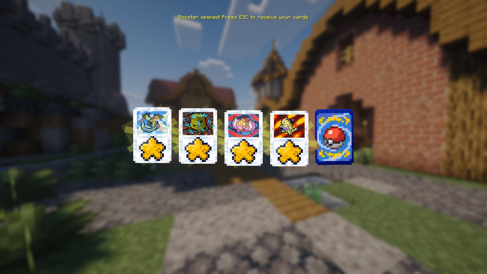

<!-- Sources: modrinth.com/mod/cobblemon-cards (features), test-server/mods/cobblemon-cards-fabric-2.0.0-beta.1.jar (lang names; ModEvents: drop on POKEMON_CAPTURED + BATTLE_FAINTED, cardDropChance + bonus;
BoosterPackItem: godPackTicketChance % per pack opened; FabricCobblemonCards: boosterChestSpawnChance % per chest; accessories slot "Card Binder"),
test-server/config/cobblemon-cards.json (= both _upload copies: cardDropChance 0.5, godPackTicketChance 0.02, boosterChestSpawnChance 1.0, trainer caps exp 1.5 / catch 1.25 / shiny 1.5,
spawn cap 3, trainerStatMinGrade 9 at 50%, lucky 5%, grading 100 ticks + 8 dust, recycler 40 ticks, restorer 5 dust + 60 ticks + 60/grade, binder pages 1/2/3/6/10/1000, masterAlbumGivesStats false),
cobblemon-cards-species-rarity.json (card rarity follows the species' tier), BoosterLootTable/ModEvents statValue per rarity (+0.3 shiny), GradingStationBlockEntity (+3% per grade), BinderItem attributes (health/armour/luck/mining flat, others % of base), 12 cards per page, the server's card add-on config (equipped binder only, drop bonus max +5 points, binder Luck max +10, binder spawn boost skips legendary/mythical; random_card loot function for raid cards),
BinderMenu SLOTS_PER_PAGE 12, cobblemonau_raids.zip raid_card/<rarity> tables (raid card drops, see network/docs/RAID-REWARDS.md),
openloader cobblemonau_card_recipes.zip (type boosters), pebbles-crate vote.json (3x Booster Pack), skiesguis bt_shop3.json (Booster Pack 40 BP), cobbledgacha_datapack (Cobblecard Dust),
Modpack keybindings.txt (open_binder + open_showcase unbound). Screenshot: Media/screenshots/booster pack opening.png (a God Pack). -->

# Cobblemon Cards



Every Pokémon has its own collectable trading card, complete with shiny holographic versions. Find them in the wild, rip open booster packs, get your best cards graded, and put them in a binder for handy bonuses.



***

## 🃏 Getting cards

| Where | How |
| --- | --- |
| 🎯 **Wild Pokémon** | Every Pokémon you **catch** or **knock out** has a **0.5%** chance to drop its card |
| 📦 **Booster Packs** | Open one for a handful of random cards |
| 💎 **Chests** | About **1 in 100** loot chests in structures has a Booster Pack inside |
| 🗳️ **Vote Crate** | Can give 3 Booster Packs |
| 🏆 **Battle Tower** | The [BP Shop](../battling/battle-tower.md) sells Booster Packs for 40 BP |
| ⚔️ **Raid Dens** | [Raids](../network/raid-dens.md) can drop a single card. Low tiers give Common cards, while 5★ and 6★ raids can give Rare, Epic and even Legendary cards |

A card's rarity depends on the Pokémon it came from. Everyday Pokémon give Common cards, while Legendaries give Legendary cards, with a small chance of landing a tier higher.

**Rarities:** Common, Uncommon, Rare, Epic, Legendary and Mythic. Shiny Pokémon drop **shiny cards**, and Megas and regional forms have their own special cards too.

***

## 📦 Booster Packs

There's a pack for every generation and every type, plus the standard Booster Pack that can hold any Pokémon.

### Crafting type packs

Turn a standard Booster Pack into a type pack of your choice:

| Ingredients | Makes |
| --- | --- |
| 1 Booster Pack + 4 **Type Gems** + 4 **Tera Shards** of the same type | 1 Booster Pack of that type |

For example, 4 Fire Gems and 4 Fire Tera Shards make a **Fire Booster Pack**.

### ✨ God Packs

Every pack you open has a **1 in 5,000** chance to be a **God Pack**, packed with ultra-rare cards. A **God Pack Ticket** guarantees your next pack is one.

<figure><figcaption>
Opening a God Pack
</figcaption></figure>

***

## 📒 Binders

Binders store your cards, and the one you **wear** gives you bonuses from the cards inside it.

| Binder | Pages | Cards |
| --- | --- | --- |
| Leather Binder | 1 | 12 |
| Iron Binder | 2 | 24 |
| Gold Binder | 3 | 36 |
| Diamond Binder | 6 | 72 |
| Netherite Binder | 10 | 120 |
| **Collection Album** | 1,000 | 12,000 (storage only, no bonuses) |

**To wear one,** open your accessories screen and drag the binder into the **Card Binder** slot. Only the binder in that slot gives bonuses.

Need more room? A **Card Cabinet** block holds as many cards as you like, with search and sorting built in.

### 💪 Card bonuses

Every card gives one bonus while it's in your worn binder. Bonuses from different cards add together, and your binder's **Stats Bonus** list shows your totals. Most bonuses are shown as a **percentage**. Health, armour, luck and mining speed are shown as plain numbers.

**How strong is a card?** It depends on its rarity, whether it's shiny, and its grade:

| Card rarity | Bonus per card |
| --- | --- |
| Common | +0.15% to +0.3% |
| Uncommon | +0.45% to +0.9% |
| Rare | +1.2% to +2.1% |
| Epic | +2.4% to +3.6% |
| Legendary | +3.6% to +5.4% |
| Mythic | +6% to +7.5% |

* ✨ **Shiny** cards get an extra **+0.9%**.
* 🔬 **Grading** makes a card **3% stronger per grade**, so a grade 10 card is 30% stronger.
* The strongest possible card, a **shiny Mythic graded 10**, gives about **+10.9%**.

**The most each bonus can give you:**

Your binder adds up everything, but some bonuses stop working past a limit. Anything over the limit doesn't do anything extra.

| Bonus on your binder | Most that counts | What that means |
| --- | --- | --- |
| 🃏 Card Drop Chance | **+5%** | Up to a 5.5% chance per Pokémon (the normal 0.5% plus 5%) |
| 🌿 Spawn boost for a type | **+200%** | Up to 3 times as many Pokémon of that type |
| 🍀 Luck | **+10** | |
| 🛡️ Armour | Up to **30** armour in total, counting your gear | Minecraft's own armour limit |
| ❤️ Max Health, ⛏️ Mining Speed, 👟 Movement Speed, ⚔️ Attack Damage, 💨 Attack Speed | No limit | |

* **Luck** gives you better finds when digging in the Underground, better drops from trainers you beat, and more treasure when fishing.
* The **spawn boost** only brings more of the Pokémon that can already spawn where you are. It never brings out Legendaries or Mythicals.

### ⭐ Trainer bonuses

Some cards also carry a **trainer bonus** (shown with a ★ on the card), the best kind there is:

| Trainer bonus on your binder | Most that counts | What that means |
| --- | --- | --- |
| ✨ Shiny Chance | **+50%** | Up to 1.5 times better shiny odds |
| 🎯 Catch Boost | **+25%** | Up to 1.25 times better catch rate |
| 📈 Exp Boost | **+50%** | Up to 1.5 times more EXP |

* Any card graded **9 or 10** has a **50%** chance to gain a trainer bonus.
* Legendary, Mythic and shiny cards have a **5%** chance to come with one straight away.

***

## 🔬 Grading and dust

| Block | What it does |
| --- | --- |
| **Grading Station** | Grades a card from **1 to 10** for **8 Cobblecard Dust**. Higher grades mean bigger bonuses. |
| **Card Recycler** | Turns cards you don't want into **Cobblecard Dust** |
| **Card Restorer** | Spends dust to raise a card's grade. Higher grades cost more and take longer. |

You can also get Cobblecard Dust from the [Gacha Machines](gacha.md).

***

## 🖼️ Showing off

| Item | What it does |
| --- | --- |
| **Holo Projector** | Shows a big 3D hologram of the card on top of it |
| **Advanced Holo Projector** | Cycles through up to 27 cards |
| **Mini Holo Projector** | Fit up to 4 on one block, each showing a small card |
| **Card Dex** | A checklist of every card you've collected |
| **Instant Dex + Card Structure Disk** | Load the disk with dust, scan wild Pokémon of one species, and print a card of it once the scan hits 100% |


💡 The keys to open your binder and the card showcase aren't set in our modpack. Set them in **Options → Controls → Key Binds** if you want quick access.

