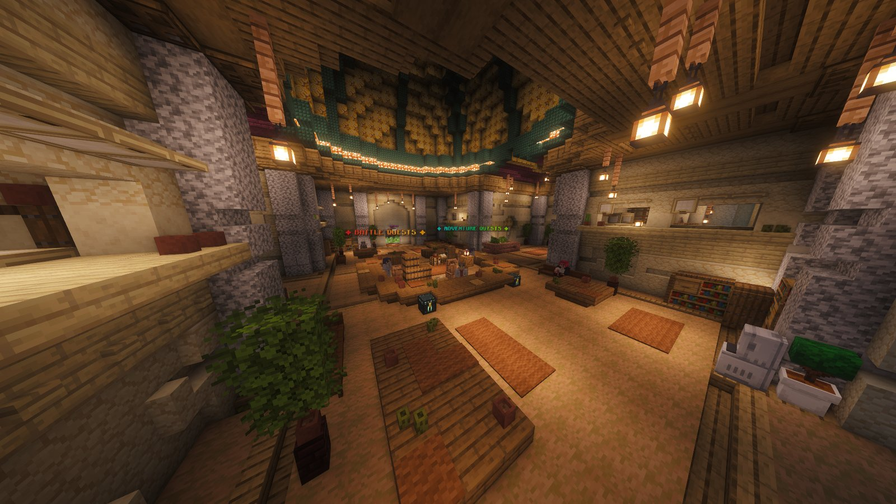

<!-- Sources: network/_upload/hub/config/cobbleau-quests/categories.json (Fishing, Catching, Battling & Raid, Fossils, Gathering; event categories like Halloween), cobbleau-quests/quests/*.json (daily + weekly quests per category), milestones.json (lifetime rewards),
test-server/config/cobbleau-quests/config.json board_defaults (4 offered / 1 active / 1 completion per type per category, per player, free abandon) and reset (4am Australia/Sydney, weekly MONDAY), dev/quests Commands.java (/quest, /quest <category>). -->

# Quests



Quests are the easiest way to earn steady money. Every day and every week you get fresh quests in five categories, and the more you finish, the bigger your milestone rewards. Type <code>/quest</code> to open your quest board.



<figure><figcaption>
The Quest Hub. Type <code>/quest_hub</code> to go there.
</figcaption></figure>

***

## 🗂️ Categories

| Category | What you'll be doing |
| --- | --- |
| 🎣 **Fishing** | Reeling in Pokémon and items |
| 🔴 **Catching** | Catching certain Pokémon, types or numbers of Pokémon |
| ⚔️ **Battling & Raid** | Winning battles, raids and Ranked matches |
| 🦴 **Fossils** | Finding and reviving fossils |
| ⛏️ **Gathering** | Collecting blocks and materials. The [Resource World](../network/resource-world.md) is perfect for these. |

During events, extra seasonal categories can appear too.

***

## 📋 How the board works



### Pick a quest

Each category offers **4 daily** and **4 weekly** quests. Everyone gets their own board, so yours might be different to your friends'.



### Accept one of each

In each category you can take on **1 daily** and **1 weekly** quest at a time. Changed your mind? You can abandon a quest for free and pick another.



### Finish it and claim

Complete the goal, then claim your reward from the board.



| | Resets |
| --- | --- |
| 🌅 **Daily quests** | Every day at **4am** (Sydney time) |
| 📅 **Weekly quests** | Every **Monday at 4am** (Sydney time) |

* Daily quests pay money. Weekly quests pay more, and some also give **crate keys**.
* Make sure you have room in your inventory before claiming a key.

***

## 🏅 Milestones

Every quest you claim counts towards your lifetime total. Hit these and the reward is paid automatically.

| Quests claimed | Reward |
| --- | --- |
| 10 | $5,000 |
| 25 | $10,000 |
| 50 | $20,000 + Plushie Crate key |
| 75 | $25,000 |
| 100 | $35,000 + Mega Stone Crate key |
| 150 | $45,000 |
| 200 | $55,000 + Hat Crate key |
| 250 | $65,000 |
| 300 | $75,000 + Shiny Crate key |
| 350 | $85,000 |
| 400 | $100,000 + Legendary Crate key |
| 500 | $120,000 |
| 600 | $140,000 |
| 700 | $160,000 + Hat Crate key |
| 800 | $180,000 |
| 900 | $200,000 |
| 1,000 | $250,000 + Radiant Crate key |

***

## ⌨️ Commands

| Command | What it does |
| --- | --- |
| `/quest` | Open your quest board |
| `/quest <category>` | Jump straight to one category, for example `/quest fishing` |
| `/quest_hub` | Go to the Quest Hub |
