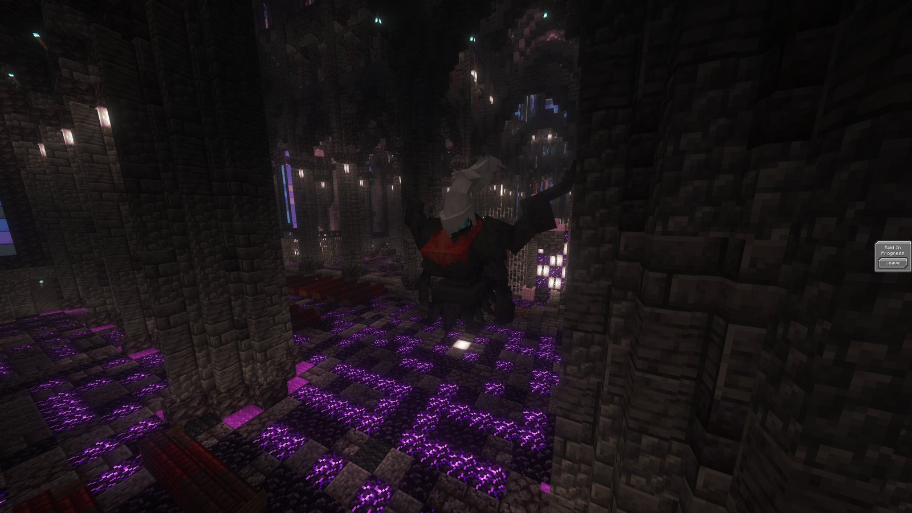

<!-- Sources: owner (a new boss rotates in every 2 weeks; Raid Key Shop is in front of the 7 star raid building on the Hub; keys are once per player per boss, permanently; keep the page generic, no per-boss details, 24 Oct),
network/_upload/{hub,survival}/openloader-1.8/cobblemonau_event_raid.zip (7 star boss scripts: shields, stat wipes, Tera/Mega phase changes, timers; pouch loot), network/_upload/{hub,survival}/config/cobblemonraiddens/tier_seven.json5 (4 players, 1 Pokemon, 1 life), blacklist.json5 (banned moves/abilities),
raid rules config (Shadow ban, Mega stripped from rewards), network/_upload/hub/config/skiesguis/guis/tier_7_raid_key*.json (key shop, one per player, $50,000). -->

# ⭐ Seven Star Raids



Seven Star Raids are the toughest fights on Cobblemon AU: a level 100 boss with scripted moves, shields and a time limit. A <strong>new boss rotates in every 2 weeks</strong>, and each one is announced on <a href="https://discord.gg/G48XBcSNk4">Discord</a>.



<figure><figcaption>
A Seven Star Raid against Mega Darkrai
</figcaption></figure>

***

## 🗝️ How it works



### Get a key

Each boss has its own **Raid Key**. Buy it from the **Raid Key Shop** in front of the Seven Star Raid building on the Hub for **$50,000**.

You can only ever buy **one key per boss**. If a boss comes back in a later rotation, you can't buy another key for it. The key is used up when you enter, so make it count!



### Form a team

Up to **4 players** can take on the boss together. Everyone needs their own key.



### Enter the raid

Hold your key in your main hand and use the boss's raid crystal at the Seven Star Raid building. Each player brings **1 Pokémon** and has **1 life**.



### Beat it, then catch it

Bring the boss's HP to zero before the timer runs out. Everyone who took part gets a Raid Pouch and a chance to catch the boss.




⚠️ You can only clear each Seven Star crystal **once**. If your team fails, the key is still gone, so prepare before you go in.


***

## 📏 The rules

| | |
| --- | --- |
| 👥 **Players** | Up to 4 |
| 🐾 **Pokémon** | 1 each, 1 life |
| 📣 **Cheers** | A few per player. The number depends on the boss. |
| ⏱️ **Time limit** | Most bosses have one, and some cut it shorter partway through the fight |
| 📉 **Stat boosts** | The boss wipes your stat boosts the first two times you raise them |
| 💀 **Fainting** | Every player Pokémon that faints lowers everyone's catch chance a little |
| 🚫 **Not allowed** | Shadow Pokémon and Shadow Tera |

**Banned in every raid:**

* **Abilities:** Wonder Guard, Perish Body
* **Moves:** Assist, Bestow, Circle Throw, Destiny Bond, Disable, Encore, Endeavor, Entrainment, Fissure, Guard Split, Guillotine, Horn Drill, Imprison, Instruct, Nature's Madness, Pain Split, Perish Song, Power Split, Roar, Ruination, Sheer Cold, Simple Beam, Skill Swap, Sky Drop, Sleep Talk, Super Fang, Taunt, Torment, Trick, Whirlwind, Worry Seed

***

## 👾 What to expect

Every boss is different, but they all fight in **phases**. As its HP drops, the boss might:

* 🛡️ put up a **shield** that soaks up damage until it breaks
* 📉 **wipe your team's stat boosts**
* 💪 **power itself up** with extra Attack, Sp. Atk or Speed
* 💠 **Terastallize** or **Mega Evolve** into a stronger form
* ⏱️ **cut time off the clock**
* 🌦️ change the **weather** or the arena

The boss announcement on Discord tells you who it is, so you can build a team that counters it.


💡 The boss has a huge HP pool, so moves that deal a set amount or a percentage of HP (Toxic, Seismic Toss and so on) barely scratch it. Seven Star Raids are a damage race.


***

## 🎁 Rewards

Every player on a winning team gets a **Raid Pouch**. Right-click it to open. Pouches usually include:

* 💵 a **cash voucher** to redeem at the PokéMart
* lots of goodies: EXP Candies, Rare Candies, stat candies, Ability Capsules and Patches, cheers, gems, diamonds, Netherite Scrap and Raid Shards
* a stack of **Tera Shards**
* bonus rolls that can include **Catching Charms**

If you catch the boss, it comes in its normal form. A Mega Evolved boss won't stay Mega.

***



Keep an eye on <a href="https://discord.gg/G48XBcSNk4">Discord</a> for the next boss and when it starts.


