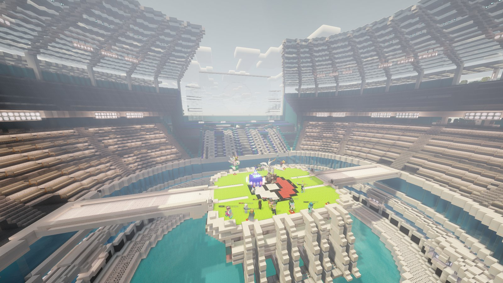

<!-- Source: owner request (18 Oct) to list tournaments as an event. No config backs this page; details (dates, format, prizes) come from each Discord announcement. -->

# 🏆 Tournaments



Every so often we run <strong>Pokémon battle tournaments</strong>. Trainers sign up, battle through a bracket, and the best walk away with prizes and bragging rights.



<figure><figcaption>
The Stadium on the Hub
</figcaption></figure>

***

## 📣 Finding out about a tournament

Tournaments are announced on our [Discord](https://discord.gg/G48XBcSNk4). Each announcement tells you:

* 📅 the date and time (AEST)
* 📝 how to sign up, and when sign-ups close
* ⚔️ the format, such as Singles or Doubles, and the level
* 🚫 any banned Pokémon, items or moves
* 🎁 the prizes

***

## ✅ Getting ready



### Sign up before the deadline

Follow the sign-up steps in the announcement. Late entries usually can't be added once the bracket is made.



### Build a legal team

Check the format and ban list carefully. If your team breaks the rules, you may be disqualified.



### Be online on time

Be on the server and ready when your match is called. If you're not there, you might forfeit the match.



***

## 🤝 Fair play

* Play your own matches on your own account.
* No bug abuse or anything that gives you an unfair advantage. The normal [server rules](../getting-started/rules.md) apply.
* Be a good sport, win or lose. Staff decisions on results are final.


💡 Want to practise? Use `/challenge <player>` for friendly battles, or jump into Ranked with `/ranked`.

