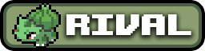
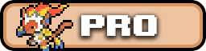
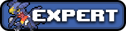
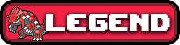
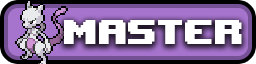
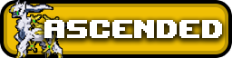

<!-- Sources: network/docs/store-rank-category.html (rank order, cumulative bonus, /rankbonus on Hub), network/_upload/hub/config/commandaliases/rankbonus.json, test-server/config/commandaliases/supporter.json (lounge), network/docs/BATTLE-TOWER-DEPLOY.md (cobblemonau.battletower.free), dev/pokemorph-standalone (perk node).
Rank badges: network/_upload/cobblemonau_resourcepack.zip assets/minecraft/textures/ranks/*.png (copied to .gitbook/assets/ranks). Store links from the owner (24 Oct). No prices by owner request. -->

# Ranks / Supporter



Cobblemon AU is run by a small team and paid for by players who support it. Ranks and the Supporter rank keep the servers online, and you get some nice perks in return.



***

## 🏅 Ranks

There are six ranks. Each one gives you its own title in chat:

| Rank | Title |
| --- | --- |
| **Rival** |  |
| **Pro** |  |
| **Expert** |  |
| **Legend** |  |
| **Master** |  |
| **Ascended** |  |

Every rank comes with:

* 🔓 **Permanent perks**, such as extra homes, handy commands and your chat title. Every rank can open the PC from anywhere with `/pc`. Higher ranks include everything from the ranks below them.
* 📦 **A monthly kit** that matches the rank you hold and refreshes each month.
* 🎁 **A one-time bonus kit** that tops you up to your rank's full bonus.

See the [Ranks store page](https://cobblemon-au.craftingstore.net/login/545117) for the full list of perks for each rank.



Ranks stack. Working your way up from Rival gives you a top-up at every step, and you end up with exactly the same bonus as someone who bought the higher rank outright. There's no penalty for starting small.



### 🎁 Claiming your bonus

Hop on the **Hub** and type `/rankbonus`. It hands over everything your rank is owed in one go. If anything is still waiting for you, you'll get a reminder when you log in.

Your regular rank kits are claimed from `/kits` on the Hub.

***

## ⭐ Supporter

Supporter is a monthly rank that sits alongside the normal ranks. Supporters get:

| Perk | What it does |
| --- | --- |
| 🦋 **PokéMorph** | Type `/pokemorph <1-6>` to turn into a Pokémon from your party. Flying Pokémon can fly in the overworld and on the Hub. `/pokemorph clear` turns you back. |
| 🛋️ **Supporter Lounge** | A private area on the Hub. Type `/supporter` to go there. |
| 🗼 **Free Battle Tower runs** | Start a new Battle Tower run without paying the entry fee. |
| 📦 **Monthly Supporter kit** | Includes a Supporter Crate key, a Silver Bottle Cap Crate key and a claim block voucher. |

***

## 🛒 Where to buy

Everything is on the Cobblemon AU store:

| Store page | What's there |
| --- | --- |
| 🏅 [Ranks](https://cobblemon-au.craftingstore.net/login/545117) | Every rank and its full list of perks |
| ⭐ [Supporter](https://cobblemon-au.craftingstore.net/category/556010) | The monthly Supporter rank |
| 🎁 [Crate Keys](https://cobblemon-au.craftingstore.net/category/545120) | Keys for every crate, with each crate's prizes and odds |
| 🌍 [Global Boosters](https://cobblemon-au.craftingstore.net/category/545385) | Server-wide boosts that help everyone who's online |

You can also type `/store` in game for a link.


⚠️ Buying ranks, items or currency from other players for real money is against the [rules](rules.md). Only buy from the official store.

