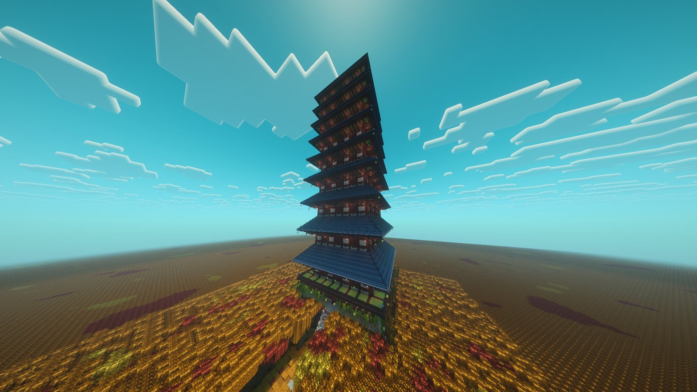

<!-- Sources: CobbleSafari wiki (cobblesafari.maxigregrze.fr, mirrored at wiki.cobblemon-realms.com/mods-guides/CobbleSafari/{hoopa_portals,sinnoh_underground,distortion_world,fight_boss}.html),
checked against test-server/config/cobblesafari/dungeon_spawn_config.json (every 900 s, chance 1.0, 32-80 blocks from a random player, overworld only, lasts 60 min, notify within 80 blocks;
underground weight 3, dungeon_jump weight 1, distortion weight 1; 0.4.0 configVersion 2 has enableNotification false), dimensional_timer_config.json (600 s per visit; dungeon_jump 1500 s from 5 Nov), dimensional_restrictions_config.json (no breaking/placing; underground bans bone meal;
distortion bans fireworks + mounting; dungeon_jump: no battles, mounting, elytra or Rotom safety), config/safarifee.json (undergroundEntryFee 500, jumpEntryFee 500, distortionEntryFee 2500, once per day), test-server/mods/cobblesafari-fabric-1.21.1-0.3.5.jar + 0.4.0 (lang names,
underground_treasure/*), Datapacks/cobblemonau_safari_tweaks (special fossils off; underground_final = 1 of 15 real fossils; giratina_core_trade = ball/EV/gender/IV/level crystals, no shiny reroll;
giratina_unique core 0.10; red_chain = 9 cores; hiker trades; hooh_unique Rainbow Feather 0.25, one random participant since uniqueLootCommunism false). Bell Tower (5 Nov 2026): csboss/hooh.json (300-600 s, ribbon 0.1),
hooh_common 1-3 Phoenix Ashes per participant, PhoenixAshesItem = bone meal on 3x3, RainbowFeatherRevive = either hand, not bypasses_invulnerability damage, regen/absorption/fire res; csboss_settings
balmBossDamagePercent 5, dispenser 30 s. Megalopolis/Paris/Ultra Space off. Dungeon donuts left out: their ingredients have no survival source. Hideaways left out (needs Trial Edition, not installed). -->

# Hoopa Portals



Every so often a strange golden ring appears near a player. Rumour has it Hoopa put them there. Step through and you could end up digging for treasure in the <strong>Sinnoh Underground</strong>, climbing Ho-Oh's <strong>Bell Tower</strong>, or lost in Giratina's <strong>Distortion World</strong>.



***

## 🌀 How Hoopa Rings appear

| | |
| --- | --- |
| ⏱️ **How often** | A new ring appears every **15 minutes**, near a random player |
| 📍 **Where** | In the overworld on **Survival** and in the **Resource World**, 32 to 80 blocks from that player |
| ⌛ **How long it stays** | **1 hour**, then it disappears |

Each ring leads to one dungeon:

| Destination | Chance |
| --- | --- |
| ⛏️ **Sinnoh Underground** | 3 in 5 |
| 🔔 **Bell Tower** | 1 in 5 |
| 🌌 **Distortion World** | 1 in 5 |

The only way into these dungeons is through one of these naturally spawning rings, so keep an eye out! 👀

***

## 🚪 Going through



### Check where it goes

Right-click the bottom of the ring. A screen shows you where it leads before you go anywhere.



### Pay the entry fee

You pay once a day for each dungeon. Going back in again the same day is free.

| Dungeon | Entry fee |
| --- | --- |
| Sinnoh Underground | **$500** |
| Bell Tower | **$500** |
| Distortion World | **$2,500** |



### Explore

The first trip into a new ring can take a moment while the dungeon loads. Once you're inside you have **10 minutes**, or **25 minutes** in the Bell Tower. You can leave early through the portal inside at any time.




⚠️ When your time is up, or the ring closes, you're sent back out automatically. Each ring's dungeon is gone for good once the ring disappears.


Inside every dungeon you **can't break or place blocks**. You can still battle in the Underground and the Distortion World.

***

## ⛏️ The Sinnoh Underground

A huge network of tunnels full of buried treasure.

### Digging

Find a dig spot in the walls to start the excavation mini-game. Uncover the items hidden in the wall before it collapses.

* **Pickaxe:** precise, but slower.
* **Hammer:** clears more at once, but shakes the wall more.
* The cracks at the top show how stable the wall is. Hammer hits and iron deposits make it collapse faster. When it gives way, the dig is over.
* You only get an item if you uncover **all** of it.

### What you can dig up

* **Spheres** in five colours, which you trade with the Hikers
* **Fossils:** all 11 single fossils. See [Fossils & reviving](../pokemon/fossils.md).
* **Evolution stones:** Fire, Water, Thunder, Leaf, Moon, Sun, Dawn, Dusk, Shiny and Ice
* **Arceus Plates** of every type
* **Key Stones and raw Mega Stones**
* Star Pieces, Heart Scales, Revives, Max Revives, Relic Coins, Tumblestones, held items like Hard Stone, Damp Rock and Iron Ball, and more

### Hikers and rewards

* **Hikers** live in the Underground. Trade them your spheres for fossils, rare items and more.
* **Reach the end** of the Underground and you get a random fossil, which can be any of the 15 including the Galar halves.


💡 Bone Meal can't be used in the Underground.


***

## 🔔 The Bell Tower

<figure><figcaption>
The Bell Tower
</figcaption></figure>

A towering pagoda above an endless autumn forest. Ho-Oh waits at the very top, and the only way up is to climb.

* **Climbing:** make your way up floor by floor using ladders, suspension bridges and **Jump Ramps**. You **can't ride Pokémon** or use an **Elytra** here.
* **Watch your step:** Rotom's safety systems don't work in the tower, so it won't save you from a bad jump.
* **No wild battles:** there are no Pokémon battles inside the tower. The only fight is Ho-Oh.

### The Ho-Oh boss

At the top of the tower, use the **Arena Altar** to summon **Ho-Oh** for a real-time boss fight, just like Giratina's. You don't attack it yourself: your Pokémon wear down its health bar while **you dodge its fiery attacks**. Stronger teams bring it down faster, and a fight lasts between 5 and 10 minutes.

* **Balms:** grab a Balm from a **Balm Dispenser** around the arena and throw it at Ho-Oh. Each hit takes off about **5%** of its health. Dispensers refill every 30 seconds, and any Balms left over disappear when the fight ends.
* **Friends:** you can fight it together. If you go down, the fight carries on as long as someone is still standing.

### Rewards

| Reward | Who gets it |
| --- | --- |
| **Phoenix Ashes** (1 to 3) | Everyone still in the arena when Ho-Oh falls |
| **Rainbow Feather** | A **1 in 4** chance per win, given to one random player |
| **Bell Tower Ribbon** | A **1 in 10** chance per win |

* **Phoenix Ashes** work like Bone Meal on a 3×3 area at once.
* **Rainbow Feather:** hold it in either hand and it saves you from a killing blow, like a Totem of Undying, then gives you Regeneration, Absorption and Fire Resistance. It's used up when it saves you, and it can't save you from falling into the void.

***

## 🌌 The Distortion World

Giratina's home, where up and down stop making sense. Islands float in the void, the floor can become the ceiling, and even water ignores gravity.

* **Platforms:** jump across floating rocks and flowers to get around. You **can't ride Pokémon** or use **Firework Rockets** here.
* **Falling into the void** sends you straight back out of the Distortion World.
* **Illusion mazes:** not everything is real. Some plants vanish, others appear out of nowhere and turn paths into mazes.

### Distorted Pokémon

Giant shadowy Pokémon that are much stronger than normal ones. They **can't be caught**, but beating them can drop **Red Chain Fragments**.

### Giratina and Turnback Cave

The only way out leads to **Turnback Cave**, where Giratina waits. Giratina takes your **Red Chain Fragments** and turns them into a **Distorted Red Crystal**, which you use on one of your Pokémon:

| Crystal | What it does |
| --- | --- |
| Distorted Red Crystal B | Changes the Pokémon's Poké Ball at random |
| Distorted Red Crystal E | Shuffles its EVs |
| Distorted Red Crystal G | Swaps its gender |
| Distorted Red Crystal I | Rerolls all of its IVs |
| Distorted Red Crystal L | Sets its level to anything from 1 to 100 |

### The Giratina boss

In the arena you can take on **Giratina's shadow** in a real-time boss fight. You don't attack it yourself: your Pokémon wear down its health bar while **you dodge its attacks**. Stronger teams bring it down faster, and it gets a second phase partway through. Throw **Distorted Balms** from the arena's dispensers to take off about 5% of its health per hit.

Beating it gives a **1 in 10** chance of a **Red Chain Core**. Craft **9 cores** into a **Red Chain**, which you throw to shackle a wild Pokémon.
