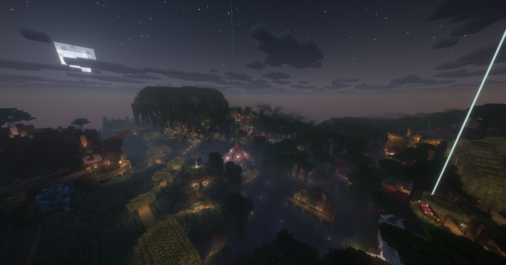

<!-- Sources: owner request (24 Oct) for a Player Towns section with the "bandle city" screenshot (cool base moved to build-competitions.md, 25 Oct); towns are posted in the #🏡│towns Discord channel (Media/screenshots, resized to .gitbook/assets/screenshots). No towns plugin is installed; towns are built with normal Flan claims and trust on Survival (network/_upload/survival/config/flan/flan_config.json: unlimited claims, Visitor/Co-Owner groups). -->

# 🏘️ Player Towns



Some of the best spots on Cobblemon AU are built by players. Team up with friends on Survival and build a town, a city, or a base everyone will want to visit.



<figure><figcaption>
Bandle City, a player-built town on Survival
</figcaption></figure>

***

## 🏗️ Starting a town



### Find your spot

Use `/rtp` on Survival to explore, and pick a place with room to grow.



### Claim the land

Use the golden hoe to claim it. Each player can make as many claims as they like, so you and your friends can claim neighbouring plots or one big area together. See [Land claims](land-claims.md).



### Bring in your friends

Stand in the claim, type `/flan menu` and add your friends as **Co-Owners** so they can build too. Add visitors as **Visitors** so they can use doors and buttons without breaking anything.



### Set homes

Everyone can type `/home set <name>` inside the town so they can get back any time.



***

## 🌟 Find a town or show yours off

Player towns are posted in the **#🏡│towns** channel on our [Discord](https://discord.gg/G48XBcSNk4). Have a look to find a town to visit or join, or post your own to find new neighbours.


⚠️ Be a good neighbour. Respect other players' claims and builds, and don't build huge villager farms, which lag the server. See the [rules](../getting-started/rules.md).

