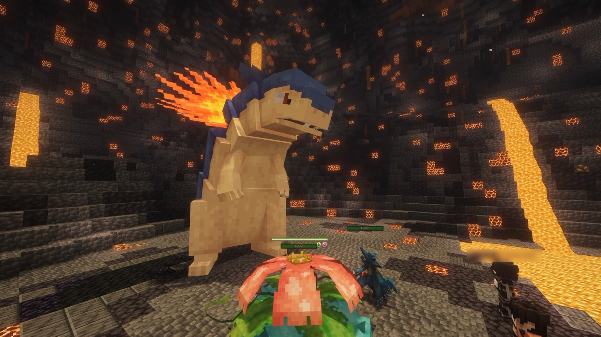

<!-- Sources: test-server/config/cobblemonraiddens/common.json5 (spawning, tier weights 12.26/20.43/34.06/27.25/5/1/0, reset_time 7200 s, cycle_mode ALL, retry_failed_raids false, sync_rewards, reward_distribution random) and tier_{one..six}.json5 (players, cheers, party size, lives, boss/reward level, IVs, catch_rate, ha_rate 0.2, raid_ai, tier 5/6 default script, mark_titan), identical to network/_upload/{hub,survival}/config/cobblemonraiddens apart from formatting;
test-server/config/openloader/packs/cobblemonau_raids.zip (30 Mega tier 6 bosses at weight 20, Eternal Floette weight 5, pseudo-legendary t6 bosses weight 0; tier 1-6 loot tables built by dev/tools/build_raid_loot.py, see network/docs/RAID-REWARDS.md for every chance), config/commandaliases/redeem.json (/redeem and /redeem combo for raid vouchers), blacklist.json5 (banned moves/abilities), raid rules config (Mega stripped from rewards), owner FAQ (claim bypass). Screenshot: Media/screenshots/raid.png (staff name tag blurred in the wiki copy). -->

# Raid Dens



Raid Dens are glowing crystals scattered around the world. Each one holds a powerful <strong>raid boss</strong>. Team up with up to 3 friends, beat it together, and everyone gets loot and a chance to catch it.



<figure><figcaption>
Taking on a Typhlosion raid boss
</figcaption></figure>

***

## 📍 Finding a den

* Raid Dens appear across the **Survival** overworld and the End, and in the **Resource World** on the Hub.
* Each den shows how many **stars** its boss has. More stars means a tougher boss and better rewards.
* Every **2 hours**, dens reset and roll a brand new boss.

How often each tier appears:

| ⭐ Tier | Chance |
| --- | --- |
| ⭐ 1 star | 12% |
| ⭐⭐ 2 star | 20% |
| ⭐⭐⭐ 3 star | 34% |
| ⭐⭐⭐⭐ 4 star | 27% |
| ⭐⭐⭐⭐⭐ 5 star | 5% |
| ⭐⭐⭐⭐⭐⭐ 6 star | 1% |

7 star bosses never appear in the wild. They're event raids: see [Seven Star Raids](../events/seven-star-raids.md).

***

## ⚔️ How a raid works



### Start the raid

Right-click the raid crystal to start. Up to **4 players** can join the same raid.



### Pick your Pokémon

Each player brings **1 Pokémon** and has **1 life**. If your Pokémon faints, you're out, but your team can keep going.



### Beat the boss

Raid bosses have a huge HP bar. Work together, and use your **3 cheers** to help your team.



### Collect your rewards

When the boss goes down, everyone gets a **Raid Pouch** and a chance to **catch the boss**.




⚠️ Each den can only be cleared **once** before it resets, and a failed raid can't be retried. Bring your best!


***

## 📊 The tiers

| Tier | Boss level | Boss HP | Catch chance | Pokémon you catch |
| --- | --- | --- | --- | --- |
| ⭐ 1 | 12 | 6x | 100% | Level 12 |
| ⭐⭐ 2 | 25 | 8x | 100% | Level 25, 1 perfect IV |
| ⭐⭐⭐ 3 | 40 | 12x | 80% | Level 40, 2 perfect IVs |
| ⭐⭐⭐⭐ 4 | 55 | 18x | 70% | Level 55, 3 perfect IVs |
| ⭐⭐⭐⭐⭐ 5 | 90 | 40x | 50% | Level 70, 4 perfect IVs |
| ⭐⭐⭐⭐⭐⭐ 6 | 100 | 48x | 25% | Level 80, 5 perfect IVs, Titan mark |

* Every raid boss has a **20%** chance to have its hidden ability, and uses the normal shiny odds.
* **5 and 6 star** bosses fight smarter. At half HP they wipe your team's stat boosts and raise their own Defence and Sp. Def.
* Pokémon you catch from a raid come in their **normal form**. A Mega boss won't stay Mega Evolved.

***

## 👑 6 star bosses

6 star raids are **Mega Evolved** bosses:

Aerodactyl, Aggron, Alakazam, Ampharos, Blastoise, Blaziken, Charizard X, Chesnaught, Delphox, Dragalge, Eelektross, Excadrill, Froslass, Gardevoir, Gengar, Glimmora, Golurk, Greninja, Houndoom, Kangaskhan, Lucario, Manectric, Mawile, Sceptile, Scizor, Scolipede, Scovillain, Staraptor, Swampert and Venusaur.

There's also a rare 6 star **Eternal Floette**, the only way to get one.

***

## 🎁 Rewards

Every player on a winning team gets a **Raid Pouch**. Right-click it to open. The higher the tier, the better the loot.

| Tier | What's inside |
| --- | --- |
| ⭐ 1 and 2 | Apricorns, Poké Balls, Great Balls, Quick Balls, EV-lowering berries, Cobblecard Dust, Relic Coins, iron nuggets, mob drops like Blaze Rods and Ender Pearls, and Nether Quartz. Tier 2 adds gold nuggets, Apricorn seeds and EXP Candies |
| ⭐⭐⭐ 3 | Poké, Great and Quick Balls, EV-lowering berries, Cobblecard Dust, Relic Coins, mob drops and Nether Quartz, plus ingots, EXP Candies, Feathers, stat Mochi, Mint Leaves and cheers |
| ⭐⭐⭐⭐ 4 | Ingots, Diamonds, EXP Candies, Feathers, stat Mochi, Mint Leaves, stat candies, cheers, Great, Quick and Ultra Balls, Cobblecard Dust, Relic Coins and mob drops, plus 3 to 7 Tera Shards in every pouch |
| ⭐⭐⭐⭐⭐ 5 | More items per pouch: Diamonds, ingots, big EXP Candies, Rare Candies, stat Mochi, Mint Leaves, stat candies, cheers, Ability Capsules, Raid Shards, booster packs, Honeycomb, Cobblecard Dust, Relic Coins, and Quick, Ultra, Repeat and Timer Balls |
| ⭐⭐⭐⭐⭐⭐ 6 | The most items per pouch: everything from tier 5 in bigger amounts, plus Ability Patches and 10 to 20 Tera Shards in every pouch |

On top of that, every pouch rolls for these:

| | ⭐ 1 | ⭐⭐ 2 | ⭐⭐⭐ 3 | ⭐⭐⭐⭐ 4 | ⭐⭐⭐⭐⭐ 5 | ⭐⭐⭐⭐⭐⭐ 6 |
| --- | --- | --- | --- | --- | --- | --- |
| 💰 Cash Voucher | $1,000 (50%) | $1,000 (60%) | $2,500 (60%) | $2,500 (36%) or $5,000 (9%) | $5,000 (34%) | $10,000 (35%) |
| 🏆 BP Voucher | | | | | 5 BP (5%) | 10 BP (10%) |
| 🃏 Trading card | Common (20%) | Common (25%) | Common or Uncommon (30%) | Common or Uncommon (35%) | Common to Epic (45%) | Uncommon to Legendary (55%) |
| 💊 Ability Capsule | | | 3% | 4% | about 20% | about 33% |
| 🧢 Silver Bottle Cap | | | | | 1.5% each | 2% each |
| ✨ Shining Silver Bottle Cap | | | | | | 3% |
| 🍎 Enchanted Golden Apple | | | | | 3% | 5% |
| 💎 Blank Mega Stone | | | | | 3% | 5% |
| 🔑 Keystone | | | | | 2% | 3% |
| 🌟 Shiny Incense | | | | | 1% | 3% |
| 🟣 Master Ball | | | | | 1% | 2% |
| 🔗 Catch Combo voucher | | | | | +2 (1.4%), +5 (0.5%) | +5 (1.4%) |
| 🛡️ Armoury Crate key | | | | | | 1% |
| 🗝️ Mega Stone Crate key | | | | | | 3% |
| 💠 Stellar Tera Shards | | | | | | 2% |
| 🔮 [Legendary Stone Shard](../pokemon/legendary-stone-shards.md) | | | | | | 0.01% |

On 4 to 6 star raids, Cash, BP and Catch Combo vouchers share one roll, so you get at most one of them per pouch.

Tera raids also drop extra Tera Shards.

**Didn't catch the boss?** Your pouch gets a bonus roll: extra EXP Candies and a chance at a **Catching Charm**. Hold a charm in your **off hand** when a boss goes down to raise your catch chance; it's used up. On 5 and 6 star raids the bonus roll can also give Rare Candies, Ability Capsules and Ability Patches. (1 and 2 star bosses are always caught, so they never get it.)

### 🎟️ Vouchers

* **Cash and BP Vouchers:** type **/redeem** to cash in every Cash and BP Voucher in your inventory at once.
* **Catch Combo vouchers:** add +2 or +5 to your current catch combo, the Pokémon you're chaining. Type **/redeem combo** while you're chaining. Your biggest voucher goes first, and it's only used up if the boost works. They can't boost a combo on a Legendary, Mythical, Ultra Beast or Paradox Pokémon.

***

## 📣 Cheers

| Cheer | Effect |
| --- | --- |
| ⚔️ **Attack Cheer** | +50% Attack and Sp. Atk for your whole team |
| 🛡️ **Defense Cheer** | +50% Defence and Sp. Def for your whole team |
| ❤️ **Heal Cheer** | Heals your team by 50% |

You can use up to 3 cheers per raid.

***

## 🚫 Banned in raids

* **Abilities:** Wonder Guard, Perish Body
* **Moves:** Assist, Bestow, Circle Throw, Destiny Bond, Disable, Encore, Endeavor, Entrainment, Fissure, Guard Split, Guillotine, Horn Drill, Imprison, Instruct, Nature's Madness, Pain Split, Perish Song, Power Split, Roar, Ruination, Sheer Cold, Simple Beam, Skill Swap, Sky Drop, Sleep Talk, Super Fang, Taunt, Torment, Trick, Whirlwind, Worry Seed


💡 Is a Raid Den inside your claim? Other players can't use it unless you allow it. See [Land claims](../network/land-claims.md) for how.

