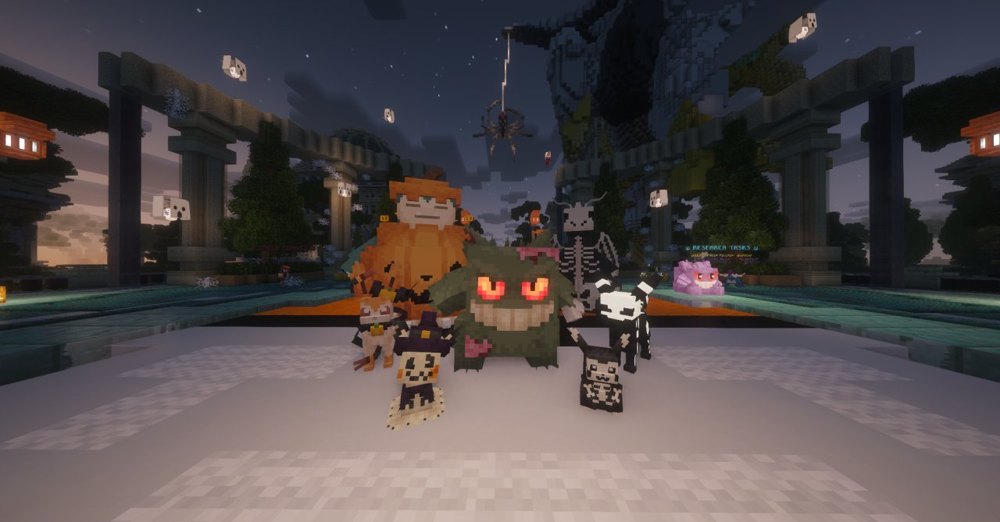

<!-- Sources: test-server/config/openloader/packs/CobblemonMoreCosmetics Release v1.1.7-1.21.x.zip (data/cobblemon/cosmetic_items/morecosmetics/**: species, item, aspects; loaded live per Downloads/survival logs "Registered the cobblemon:cosmetic_items registry"),
network/_upload/{hub,survival}/openloader-1.8/cobblemonau_easter_locked.zip (empties the 3 Easter item rules), cobblemonau_cosmetic_evolutions.zip (9 forms keep their look when evolving), Halloween_2025_DataPack.zip (halloween forms, event only). Easter forms left off the page for now (owner 26 Oct). Screenshot: Media/screenshots/halloween skins.png.
pangoro_operator.json is left out: its "pokemon" field is ["operator"], so it never applies. -->

# Cosmetic forms



Lots of Pokémon have alternate looks you can unlock with an everyday item. They're purely cosmetic: your Pokémon's stats, type and moves stay exactly the same.



***

## 👕 How to apply one

1. Send out your Pokémon and hold the matching item.
2. Hold **Shift** and right-click your Pokémon to open its interaction wheel.
3. Choose **Change cosmetic item**. Your Pokémon wears the item and its new look appears straight away.

To change back, open the wheel again and take the item back. You can also swap straight to a different cosmetic item.

Some Pokémon have an **alternate colour** version of their look, which uses a different item.

***

## 📋 Every cosmetic look



| Pokémon | Look | Item | Alt colour item |
| --- | --- | --- | --- |
| Gardevoir | Ice Dragon | Snow Block | Powder Snow Bucket |
| Golisopod | Ice Raider | Snow Block | |
| Greninja | Winter | Snow Block | Powder Snow Bucket |
| Mewtwo | Boundary | Snow Block | Powder Snow Bucket |
| Ninetales | Aurora | Star Sweet | Nether Star |
| Umbreon | Aurora | Snow Block | |
| Vulpix, Ninetales | Holiday | Snow Block | |
| Weavile | Skier | Snow Block | |



| Pokémon | Look | Item |
| --- | --- | --- |
| Charizard | Sinnoh | Fire Gem |
| Decidueye | Sinnoh | Grass Gem |
| Garchomp | Sinnoh | Dragon Gem |
| Gardevoir | Sinnoh | Fairy Gem |
| Greninja | Sinnoh | Water Gem |
| Lucario | Sinnoh | Fighting Gem |



| Pokémon | Look | Item |
| --- | --- | --- |
| Eevee | Valentine's | Love Sweet |
| Flareon | Valentine's | Love Sweet |
| Jolteon | Valentine's | Love Sweet |
| Vaporeon | Valentine's | Love Sweet |
| Roserade | Valentine's | Love Sweet |



| Pokémon | Look | Item |
| --- | --- | --- |
| Cinderace | Captain | Black Wool |
| Cinderace | Pastel | Lucky Egg |
| Ho-Oh | Steampunk | Gold Ingot |
| Sawk | Festival | Black Belt |
| Throh | Festival | Black Belt |
| Zoroark (not Hisuian) | Ghost | Spell Tag |



| Pokémon | Look | Item | Alt colour item |
| --- | --- | --- | --- |
| Articuno (not Galarian) | Steampunk | Copper Ingot | |
| Zapdos (not Galarian) | Steampunk | Copper Ingot | |
| Moltres (not Galarian) | Steampunk | Copper Ingot | |
| Blaziken | Magma | Magma Block | |
| Carbink | Royal | King's Rock | |
| Ceruledge | Greninja | Mystic Water | |
| Charizard | Knight | Iron Helmet | |
| Cyclizar | Ancient | Red Wool | |
| Decidueye | Ninja | Blue Wool | |
| Drampa | New Year | Lantern | |
| Grumpig | Legend | Potato | |
| Haxorus | Reaper | Skeleton Skull | |
| Incineroar | Warmonger | Iron Ingot | |
| Latios | Fighter | Iron Ingot | Powder Snow Bucket |
| Lucario | Covert | Covert Cloak | |
| Mewtwo | Covert | Covert Cloak | |
| Magcargo | Racer | Iron Helmet | |
| Meowscarada | Dark Magician | Dusk Stone | |
| Mimikyu | Pawmi | Orange Wool | |
| Minun | Cheerleader | Lime Wool | |
| Plusle | Cheerleader | Pink Wool | |
| Pichu, Pikachu, Raichu | Yellow Hat | Yellow Wool | |
| Smoliv | Uva | Sweet Berries | |
| Snorlax | Chef | White Wool | |
| Typhlosion | Chef | White Wool | |
| Tinkaton | Eternal | Wither Rose | |
| Wooper | Dignified | Emerald | |



***

## 🐣 Event forms

Some forms can't be made with an item. They're given out during events and in event crates, and they stay with your Pokémon for good.

### 🎃 Halloween skins

Spooky Halloween looks, given out during Halloween events and in Halloween crates.

<figure><figcaption>
Halloween skins
</figcaption></figure>


💡 A few event and cosmetic forms keep their look when they evolve.

