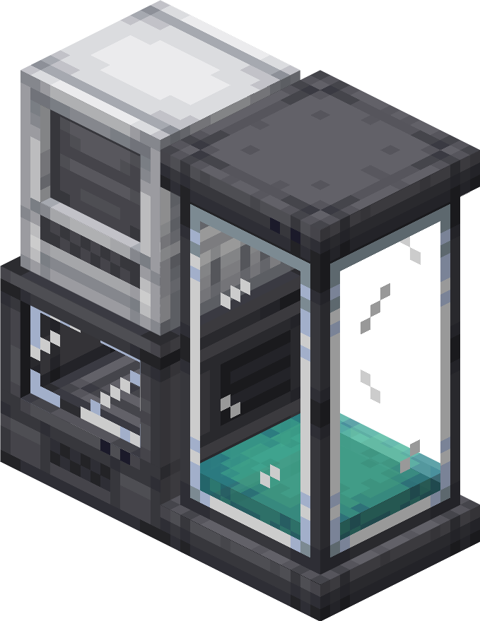

<!-- Sources: test-server/mods/Cobblemon-fabric-1.8.1+1.21.1.jar: data/cobblemon/fossils/*.json (15 recipes), data/cobblemon/natural_materials/{vanilla,cobblemon}.json (organic values),
data/cobblemon/recipe/{fossil_analyzer,restoration_tank,monitor}.json, FossilMultiblockBuilder (monitor above analyzer, tank bottom beside it), FossilMultiblockStructure (128 organic to start,
14400 ticks = 12 min, 6000 ticks = 5 min owner protection, Poke Ball to collect, rollShiny/rollAlpha), FossilMultiblockEntity (Up-Grade: Porygon lv20 / 20% Porygon2 lv25; Dubious Disc: 50% Porygon-Z lv35;
monitorShinyRate/monitorAlphaRate), lang en_us.json (names).
network/_upload/{hub,survival}/config/cobblemon/main.json: fossilMachineShinyChance 4000, fossilMachineAlphaChance 800, monitorShinyRate 8000, monitorAlphaRate 1600.
test-server/config/unchained/resurrection/*.json (revive combo, see catch-combos.md). test-server/mods/lost_lore-fabric-3.1.0.jar data/cobblemon/fossils (clones).
Where to find: Cobblemon worldgen fossil sites (loot_table/fossils/*, suspicious blocks); Datapacks/cobblemonau_safari_tweaks (Underground treasure: real fossils diggable, special CobbleSafari fossils off;
dimensional_objectives/underground_final.json = 1 of 15 real fossils; cstrader/hiker.json sphere -> fossil trades); config/safarifee.json undergroundEntryFee 500.
Images: Media/wiki-renders/fossil machine.png. -->

# Fossils & reviving



Dig up a fossil, bring it back to life in a <strong>Fossil Machine</strong>, and it might even come out shiny or as an Alpha. Revived Pokémon are far more likely to be shiny than wild ones.



***

## 🔧 Building a Fossil Machine

The machine is three blocks that join together. Build it exactly like this, or it won't work:

<figure><figcaption>
The Data Monitor on top of the Fossil Analyzer, with the Restoration Tank right next to it
</figcaption></figure>

| Block | Crafted from | Where it goes |
| --- | --- | --- |
| 🔬 **Fossil Analyzer** | Cobbled Deepslate, Amethyst Shards, Iron Ingots, Glass and Redstone | On the ground |
| 🖥️ **Data Monitor** | Iron Ingots, Copper Ingots, Glass and a Redstone Torch | On top of the Fossil Analyzer |
| 🧪 **Restoration Tank** | Iron Ingots, Glass, a Revive and a Composter | Right next to the Fossil Analyzer (it's two blocks tall) |

You'll hear the machine power up when all three parts are in place.

***

## 🦴 Reviving a fossil



### Fill the tank

Right-click the **Restoration Tank** with plants and food until it's full. Better items fill it faster:

| Item | Fills |
| --- | --- |
| Seeds, Melon Slices, Dried Kelp, Paper | A tiny bit |
| Most plants, flowers, leaves and berries | A little |
| Bread, Carrots, Potatoes, Apples, Bone Meal, cooked meat | A bit more |
| Raw meat and fish, Eggs, Rotten Flesh, Leather, Slimeballs, Pumpkins | More again |
| Hay Bales, Cake, Honey Blocks, Rabbit Stew, fish buckets | About an eighth of the tank |
| Revives, Golden Apples, Ghast Tears, Miracle Seeds | A quarter of the tank |
| Max Revives, Nautilus Shells, Dragon's Breath | Half the tank |
| Nether Stars, Enchanted Golden Apples | The whole tank |

You get your bowls, bottles and buckets back.



### Put the fossil in

Right-click the **Fossil Analyzer** with your fossil. The Galar fossils need **two** halves, so put both in. Changed your mind? Right-click with an empty hand to take the last fossil back out before the machine starts.



### Wait 12 minutes

The machine starts by itself once the tank is full and a fossil is in. The Data Monitor shows how far along it is. Stay nearby, as the machine only runs while you're close enough for its area to be loaded.



### Collect your Pokémon

Right-click the machine with a **Poké Ball**. Your new Pokémon goes into your party in that ball.

For the first **5 minutes**, only the player who put the fossil in can collect it. After that, anyone can.



***

## 📋 Fossils you can revive



| Fossil | Pokémon |
| --- | --- |
| Old Amber Fossil | Aerodactyl |
| Helix Fossil | Omanyte |
| Dome Fossil | Kabuto |
| Root Fossil | Lileep |
| Claw Fossil | Anorith |
| Skull Fossil | Cranidos |
| Armor Fossil | Shieldon |
| Cover Fossil | Tirtouga |
| Plume Fossil | Archen |
| Jaw Fossil | Tyrunt |
| Sail Fossil | Amaura |



Galar fossils come in halves. Put one top half and one bottom half in together.

| | Fossilized Drake | Fossilized Dino |
| --- | --- | --- |
| **Fossilized Bird** | Dracozolt | Arctozolt |
| **Fossilized Fish** | Dracovish | Arctovish |



These aren't fossils, but they revive in the same machine. Each one comes out with at least **4 perfect IVs**.

| Put in | Pokémon |
| --- | --- |
| Nether Star + Miracle Seed | Clone Bulbasaur |
| Nether Star + Charcoal | Clone Charmander |
| Nether Star + Mystic Water | Clone Squirtle |

See [Lost Lore exclusives](lost-lore.md) for more about the clones.



***

## ✨ Shiny & Alpha odds

| | Revived fossil | Wild spawn |
| --- | --- | --- |
| ✨ **Shiny** | **1 in 4,000** | 1 in 32,768 |
| 🦣 **Alpha** | **1 in 800** | Rare herds |

Reviving the **same Pokémon** over and over builds a **revive combo**, which makes your odds even better:

| Revive combo | Shiny odds | Perfect IVs |
| --- | --- | --- |
| 0 to 4 | 1 in 4,000 | |
| 5 | | 1 |
| 10 | | 2 |
| 15 | 1 in 2,928 | |
| 20 | | 3 |
| 30 | 1 in 2,484 | |
| 35+ | | 4 |
| 50 | 1 in 2,157 | |
| 80+ | 1 in 1,906 | |

* Your revive combo resets to zero when a combo shiny comes out.
* The more fossils you've revived in total, the better your hidden ability chance: 1 in 200 after 50 revives, 2 in 200 after 100, and 3 in 200 after 150.

See [Catch combos](catch-combos.md) for the other kinds of combo.

***

## 📍 Where to find fossils

* **Fossil dig sites.** Small fossil sites are scattered all over the overworld, like old skeletons, buried trees, frozen ponds and underwater vents. Brush the **suspicious sand and gravel** there with a **Brush** to dig up fossils. The [Resource World](../network/resource-world.md) is a great place to look.
* **Sinnoh Underground.** Type `/underground` (it's on Survival, with a **$500** entry fee once a day). Dig fossils out of the walls, and every time you clear the Underground you get a random fossil, which can be any of the 15 including the Galar halves. The **Hiker** down there also trades spheres for fossils.


💡 The **Fossils** category on the [quest board](../economy/quests.md) pays you for reviving fossils, so check your quests before you start.


***

## 💾 Bonus: Porygon from the Data Monitor

Your Fossil Machine can also make **Porygon**. Right-click the **Data Monitor** of a finished machine with one of these:

| Use | You get |
| --- | --- |
| **Up-Grade** | A level 20 Porygon, or a 1 in 5 chance of a level 25 Porygon2 |
| **Dubious Disc** | A 1 in 2 chance of a level 35 Porygon-Z. Otherwise nothing happens and the disc is used up. |

The Porygon pops out next to the machine as a **wild** Pokémon, so have your Poké Balls ready. It has a 1 in 8,000 chance to be shiny and a 1 in 1,600 chance to be an Alpha. You can buy both items in the [Battle Tower](../battling/battle-tower.md) BP Shop.
